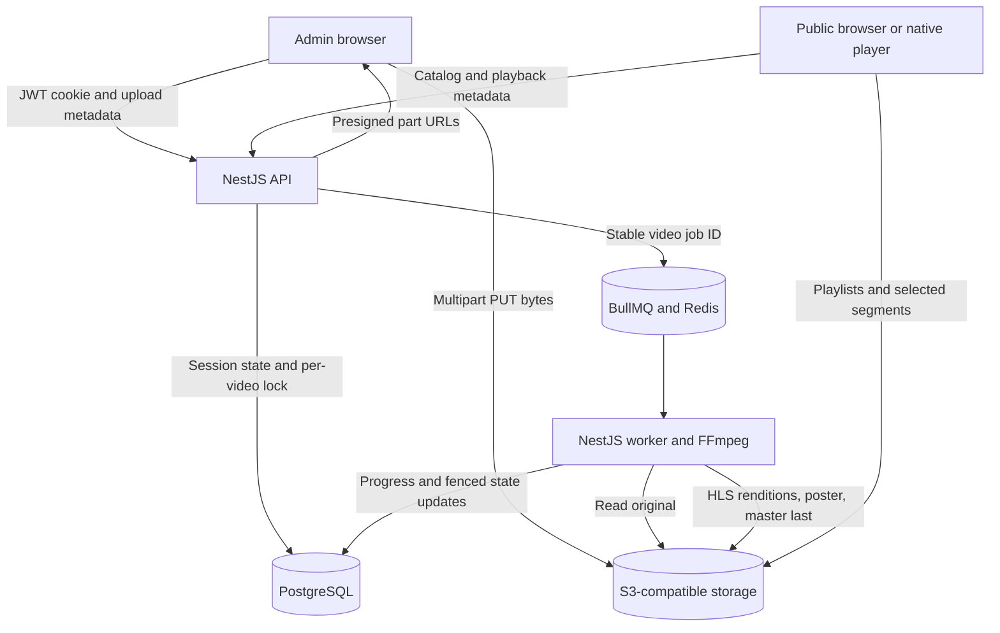

# Architecture

UGN Video separates upload orchestration, media processing and public playback.
This is a single-admin prototype, not a production streaming service.

## Upload and persistence

The API validates shared zod schemas, creates a Video row and multipart upload,
and signs 64 MiB parts for one hour. Browser PUTs go directly to storage; credentials
stay on the server. Sequential parts simplify pause/retry and bound concurrent
transfers. A 10 GiB file needs 160 parts, well below S3's 10,000-part limit. This
trades upload throughput for predictable behavior on a home connection.

Browser localStorage preserves queue metadata. File handles are held only in memory;
a closed tab requires original-file reselection. Matching uses name, size and last
modification time, not a content hash. Resume lists saved storage parts and sends
missing ones; progress may fall to the last confirmed part. The interrupted part
can be retransmitted. A dropped connection pauses for an explicit Resume action.

Completing an upload verifies the stored object length before queueing. PostgreSQL
and Redis are not an atomic transaction: a periodic reconciliation pass repairs
storage-to-DB and DB-to-queue gaps using the video ID as the BullMQ job ID.

## Data model

One Prisma Video model is authoritative; browser queue/history/watch position is not
stored as an account-backed history table.

| Fields | Purpose |
| --- | --- |
| id | UUID primary key; object-key prefix and stable queue job ID |
| title, description, filename | Validated metadata and original filename |
| size | Declared integer bytes, represented as Float; 20 GiB ceiling is exactly representable |
| uploadId | Active multipart upload identifier; cleared after completion |
| status, progress, duration, error | Lifecycle, encoding percentage, probed duration and bounded error detail |
| processingToken | Attempt identity fencing stale worker database updates |
| processingStage, estimatedCompletionAt, processingHeartbeatAt | Visible processing status and provisional ETA |
| createdAt, updatedAt | Ordering and idle-upload expiration |

States include UPLOADING, UPLOADED, PROCESSING, RETRYING, READY, FAILED,
STOPPING, STOPPED and DELETING. Status is a string in the database and a shared
TypeScript union; a database enum/check constraint would strengthen production use.

## Worker correctness and resource boundaries

BullMQ renews the 120-second job lock. Stalled-job recovery follows lock expiry;
a killed worker was observed restarting the same job and reaching READY. Automatic
failure attempts are limited to three with exponential backoff. Retries start from
the original: there is no encode checkpoint. PostgreSQL advisory transaction locks
serialize API, recovery and worker-claim transitions for each video. Stable job IDs
prevent duplicate queued jobs; this is recoverable coordination, not exactly-once
execution across services.

The worker checks both Redis ownership and processingToken during an attempt.
Losing ownership or receiving Stop aborts subprocesses and storage transfers. The
master is uploaded last, then READY is set. Objects are public once uploaded, so
READY is a catalog/publication gate rather than a security boundary for guessed URLs.
Cross-service fencing reduces stale writes but is not a transactional object-store
publish; immutable attempt prefixes would strengthen production isolation.

One worker runs one job, with a two-CPU/two-GiB Compose limit. Originals download
as streams to /work. FFmpeg uses two encode threads and one filter thread. A disk
monitor checks every two seconds, with a 100 GiB per-attempt soft limit and 512 MiB
free-space floor. These are safety guards, not reservations or filesystem quotas.
Output and scratch coexist with original storage on the Docker host. Preflight
must budget for all copies, not only the uploaded file. Orphan scratch ownership
metadata supports cleanup after lock loss; finally blocks clean normal exits.

## Media format and playback

FFprobe validates the actual container, video stream and finite positive duration.
The worker produces three fixed heights: 1080, 720 and 480, preserving aspect ratio
with even dimensions and yuv420p. Low-resolution inputs are currently upscaled.
H.264 plus optional AAC stereo in MPEG-TS HLS favors broad browser/native support.
Six-second target segments and forced keyframes balance request volume and seeking;
frame timing can make actual segment durations vary. CRF 23 with maxrate/bufsize
limits is not constant bitrate. Master metadata measures complete segment bytes,
including audio/mux overhead, and records actual encoded dimensions. Peak bandwidth
uses a conservative maximum-segment-rate bound plus 10%, not a perceptual quality metric.

Public catalog includes only READY rows. Playback API returns status, master URL,
poster, duration and explicit rendition URLs; missing IDs return HTTP 200 with
NOT_FOUND. Browsers prefer advertised native HLS support; otherwise hls.js uses
Media Source Extensions. Unsupported cases and failed/network/missing states are
shown explicitly. Native quality selection switches rendition playlists and restores
position; hls.js selects levels. Watch position is browser-profile local. VLC playback
passed; Safari, actual AVPlayer/ExoPlayer and in-app webviews remain unverified.

## Cleanup, storage and deployment

Cancel/expired tracked uploads move through DELETING, abort the recorded multipart
ID, delete objects and remove the row. Retriable failures preserve state. Backend
maintenance must run; storage outages delay cleanup. Untracked multipart discovery
lists all uploads and locally filters originals/ keys because a live MinIO prefix
listing discrepancy omitted saved uploads. The sweep retains tracked active uploads
and skips unrelated keys. Captured-ID snapshot/verify proves cleanup independently
of inventory; cancellation passed with printed evidence and expiry was user-confirmed.
No live untracked-orphan injection test has been recorded.

MinIO persists media in a named volume. Its pinned release uses server-wide CORS;
AWS mode writes/readbacks bucket CORS. Shared explicit origins support localhost and
LAN access. Playlists use the HLS MIME and no-cache, TS segments video/mp2t and
posters image/jpeg with one-hour public cache. Originals have no anonymous policy
grant; only processed videos/ objects are public. Real AWS has not been tested.

Development uses Vite and tsx in Docker, Prisma db push, a configured environment
admin and JWT httpOnly cookies. Production needs HTTPS, bundled application builds,
migrations, hashed account credentials, rate limiting, CSRF controls, monitoring,
backups and least-privilege storage roles. Local Compose is not public hosting.

## Alternatives and decisions

| Alternative | Decision |
| --- | --- |
| Stream upload through API | Rejected: consumes API bandwidth/disk and couples large transfers to request lifetime |
| Custom chunk server | Rejected: S3 multipart already provides part identity, persistence and abort semantics |
| Parallel browser parts | Deferred: sequential uploads simplify pause/reconciliation; tune from measurements |
| Transcode synchronously in API | Rejected: long jobs need independent retries, locks and resource limits |
| Three parallel encodes | Deferred: sequential passes suit the constrained demo host; cost is more elapsed time |
| Whole MP4 playback | Rejected as primary output: HLS enables ABR and segment-based seeking |
| DASH/HEVC/AV1/CMAF | Deferred to avoid expanding compatibility scope; evaluate after measured HLS support |
| Managed end-to-end video SaaS | Not used; the upload and processing pipeline is implemented explicitly |
| Chunked/checkpointed encoding | Production priority for long files; substantially more timeline/stitching complexity |
